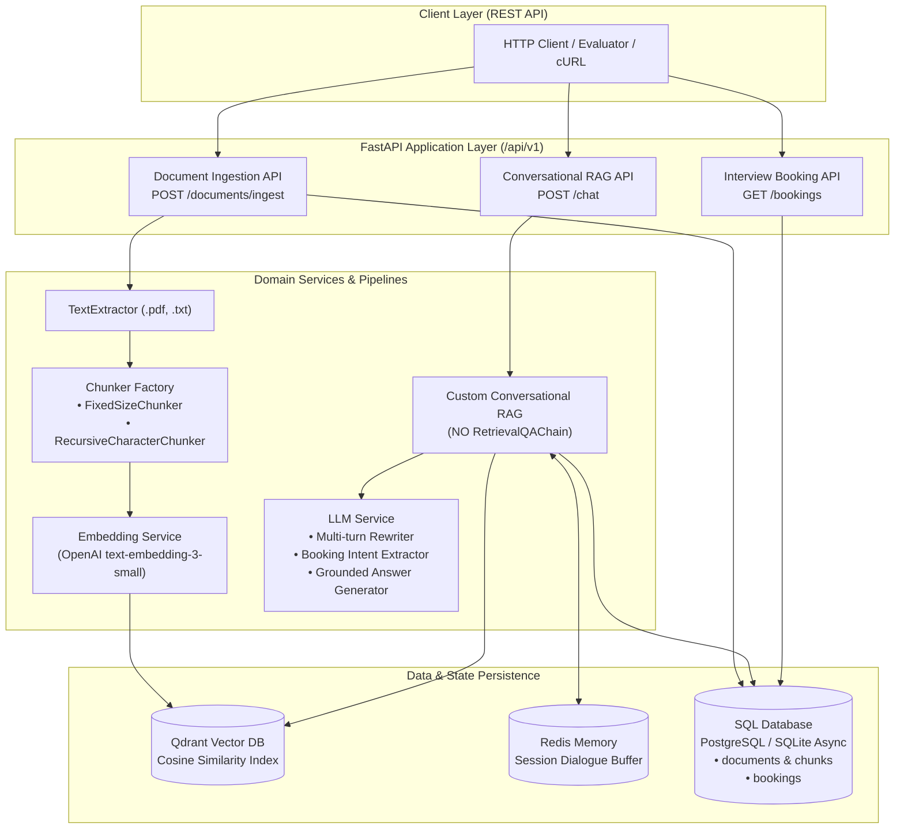

# Palm Mind AI - Document Ingestion & Conversational RAG Engine

A production-grade, asynchronous backend developed for the **Palm Mind AI (Palm Mind Technology)** engineering hiring assessment.

Built using **FastAPI**, **SQLAlchemy 2.0 (Async)**, **Qdrant Vector Database**, **Redis**, and modern **Pydantic v2**, this service delivers an end-to-end knowledge retrieval engine with multi-turn conversation memory and an automated LLM-driven interview scheduling agent.

---

## Architecture Overview



---

## Requirements & Constraints Compliance Checklist

| Requirement | Implementation Details | Status |
| :--- | :--- | :---: |
| **No FAISS / Chroma** | Uses **Qdrant** (supports remote server and embedded local execution). | **Compliant** |
| **No UI** | Headless backend with rich interactive OpenAPI / Swagger UI at `/docs`. | **Compliant** |
| **No RetrievalQAChain** | Fully engineered custom RAG pipeline in `app/services/rag/rag_pipeline.py`. | **Compliant** |
| **Document Ingestion API** | Accepts `.pdf` (via `pypdf`) and `.txt` files; extracts clean text. | **Compliant** |
| **Two Chunking Strategies** | Selectable: `fixed_size` (sliding window) vs `recursive_character` (hierarchical). | **Compliant** |
| **Vector DB Storage** | Stores dense vector embeddings and metadata in **Qdrant**. | **Compliant** |
| **SQL/NoSQL Metadata** | Saves document, chunk, and booking records via **SQLAlchemy 2.0 Async** (SQLite / PostgreSQL). | **Compliant** |
| **Conversational RAG API** | Answers user queries grounded in retrieved document snippets with source attribution. | **Compliant** |
| **Redis Chat Memory** | Stores and retrieves multi-turn dialogue per `session_id` with TTL. | **Compliant** |
| **Multi-turn Queries** | Reformulates queries in conversational context before semantic search. | **Compliant** |
| **Interview Booking (LLM)** | Detects booking intent and extracts `name`, `email`, `date`, `time` via LLM. | **Compliant** |
| **Store Booking Info** | Persists interview records into `bookings` relational table. | **Compliant** |
| **Industry Standards** | 100% typed, Pydantic v2 schemas, async I/O, layered clean architecture, comprehensive test suite. | **Compliant** |

---

## Project Structure

```
├── app/
│   ├── main.py                     # FastAPI entry point, lifespan, CORS, and exception handling
│   ├── api/
│   │   ├── deps.py                 # Dependency injection (AsyncSession)
│   │   └── v1/
│   │       ├── router.py           # API v1 central router
│   │       ├── ingestion.py        # POST /documents/ingest, GET /documents, GET /documents/{id}
│   │       ├── chat.py             # POST /chat, GET/DELETE /chat/{session_id}/history
│   │       └── bookings.py         # GET /bookings, GET /bookings/{id}, POST /bookings
│   ├── core/
│   │   ├── config.py               # Pydantic BaseSettings (.env loading)
│   │   ├── exceptions.py           # Domain exceptions
│   │   └── logging.py              # Structured logging configuration
│   ├── db/
│   │   ├── base.py                 # SQLAlchemy DeclarativeBase
│   │   └── session.py              # Async engine, sessionmaker, init_db()
│   ├── models/
│   │   ├── document.py             # Document & DocumentChunk ORM models
│   │   └── booking.py              # Booking ORM model
│   ├── schemas/
│   │   ├── ingestion.py            # Ingestion request/response Pydantic models
│   │   ├── chat.py                 # Chat request/response & source models
│   │   └── booking.py              # Booking request/response & extraction models
│   └── services/
│       ├── extraction/
│       │   └── text_extractor.py   # Robust .txt and .pdf text extraction
│       ├── chunking/
│       │   ├── base.py             # BaseChunker abstract base class
│       │   ├── fixed_size.py       # Strategy 1: Fixed-size chunking with word-boundary awareness
│       │   └── recursive_character.py # Strategy 2: Hierarchical recursive chunking
│       ├── embeddings/
│       │   └── embedding_service.py# OpenAI embeddings + deterministic offline fallback
│       ├── vector_store/
│       │   └── qdrant_store.py     # Qdrant client, collection initialization & search
│       ├── memory/
│       │   └── redis_memory.py     # Redis multi-turn session memory + fakeredis fallback
│       ├── llm/
│       │   └── llm_service.py      # LLM query rewriter, booking extractor, RAG synthesis
│       ├── rag/
│       │   └── rag_pipeline.py     # Custom RAG orchestration pipeline
│       └── booking/
│           └── booking_service.py  # Interview booking persistence and querying
├── sample_data/
│   ├── palm_mind_overview.txt      # Sample text document for testing
│   ├── palm_mind_handbook.pdf      # Sample PDF document for testing
│   └── generate_sample_pdf.py      # PDF generator script
├── tests/
│   ├── conftest.py                 # Pytest async fixtures and in-memory test DB
│   ├── test_extraction.py          # PDF/TXT extraction tests
│   ├── test_chunking.py            # FixedSize vs RecursiveCharacter chunker tests
│   ├── test_redis_memory.py        # Redis conversational memory tests
│   ├── test_booking.py             # Interview booking & LLM extraction tests
│   ├── test_rag_pipeline.py        # Custom RAG pipeline tests
│   └── test_api_endpoints.py       # HTTP integration tests for all endpoints
├── Dockerfile                      # Multi-stage production container build
├── docker-compose.yml              # FastAPI + PostgreSQL + Redis + Qdrant
├── requirements.txt                # Pinned dependency manifest
├── .env.example                    # Environment variable template
└── README.md                       # Comprehensive documentation
```

---

## Chunking Strategies Comparison

The backend provides two selectable chunking strategies via the `chunking_strategy` parameter:

| Feature | Fixed-Size Chunking (`fixed_size`) | Recursive Character Chunking (`recursive_character`) |
| :--- | :--- | :--- |
| **Mechanism** | Slides a window of fixed characters with configurable step/overlap. | Hierarchically splits by `["\n\n", "\n", ". ", " ", ""]`. |
| **Boundary Awareness** | Snaps to closest whitespace boundary to avoid cutting words. | Preserves complete semantic units (paragraphs, sentences). |
| **Best Used For** | Uniform token/character distribution across documents. | Structured documents, articles, handbooks, and natural prose. |
| **Default Parameters** | `chunk_size=500`, `chunk_overlap=50` | `chunk_size=500`, `chunk_overlap=50` |

---

## Getting Started

### Option A: Local Development (Recommended)

Run standalone Qdrant and Redis using Docker Compose, while running FastAPI locally for active development and inspection:

```bash
# 1. Clone repository
git clone <your-github-repo-url>
cd <repo-folder>

# 2. Create and activate a Python virtual environment
python3 -m venv .venv
source .venv/bin/activate

# 3. Install dependencies
pip install -r requirements.txt

# 4. Copy environment configuration and supply your OpenAI API key
cp .env.example .env
# Set OPENAI_API_KEY="sk-..." in .env

# 5. Spin up standalone Qdrant and Redis services
docker compose up -d qdrant redis

# 6. Start the FastAPI development server
uvicorn app.main:app --reload --port 8000
```

The interactive documentation will be available at: **[http://localhost:8000/docs](http://localhost:8000/docs)**.

---

### Option B: Docker Compose (Full Production Stack)

To run the complete production stack with **FastAPI**, **PostgreSQL 16**, **Redis 7**, and **Qdrant**:

```bash
# Start all services in the background
docker compose up -d --build

# Inspect running containers
docker compose ps

# View application logs
docker compose logs -f api
```

Services will be accessible at:
- **FastAPI API & Swagger**: `http://localhost:8000/docs`
- **Qdrant Vector DB Web UI / Dashboard**: `http://localhost:6333/dashboard`
- **Redis Server**: `localhost:6379`
- **PostgreSQL**: `localhost:5432`

---

## API Documentation & Sample Requests

### 1. Ingest a Text File (Recursive Chunking)

```bash
curl -X POST "http://localhost:8000/api/v1/documents/ingest" \
  -F "file=@sample_data/palm_mind_overview.txt" \
  -F "chunking_strategy=recursive_character" \
  -F "chunk_size=500" \
  -F "chunk_overlap=50"
```

**Response (`201 Created`):**
```json
{
  "document_id": "a92c30f4-52d3-4628-912f-04285b733734",
  "filename": "palm_mind_overview.txt",
  "file_type": "txt",
  "file_size_bytes": 2218,
  "chunking_strategy": "recursive_character",
  "chunk_size": 500,
  "chunk_overlap": 50,
  "total_chunks": 5,
  "vector_collection": "palm_mind_documents",
  "status": "PROCESSED",
  "created_at": "2026-10-13T12:00:00Z",
  "sample_chunks": [
    {
      "chunk_index": 0,
      "char_count": 482,
      "vector_id": "78643922-b5cf-4df5-bba9-cf56372b21cf",
      "preview": "Palm Mind AI (Palm Mind Technology) develops cutting-edge artificial intelligence solutions..."
    }
  ]
}
```

---

### 2. Ingest a PDF File (Fixed-Size Chunking)

```bash
curl -X POST "http://localhost:8000/api/v1/documents/ingest" \
  -F "file=@sample_data/palm_mind_handbook.pdf" \
  -F "chunking_strategy=fixed_size" \
  -F "chunk_size=400" \
  -F "chunk_overlap=40"
```

---

### 3. Multi-Turn Conversational RAG Query

**Turn 1: Initial Query**
```bash
curl -X POST "http://localhost:8000/api/v1/chat" \
  -H "Content-Type: application/json" \
  -d '{
    "session_id": "session-101",
    "query": "What vector databases does Palm Mind AI use?"
  }'
```

**Turn 2: Contextual Follow-up (Multi-turn Anaphora Resolution)**
```bash
curl -X POST "http://localhost:8000/api/v1/chat" \
  -H "Content-Type: application/json" \
  -d '{
    "session_id": "session-101",
    "query": "What is their latency performance?"
  }'
```

**Response:**
```json
{
  "session_id": "session-101",
  "query": "What is their latency performance?",
  "rewritten_query": "What is the latency performance of Palm Mind AI vector databases?",
  "response": "Palm Mind AI vector indexing utilizes Qdrant, Milvus, and Pinecone, delivering sub-50ms approximate nearest neighbor search latency [1].",
  "sources": [
    {
      "document_id": "a92c30f4-52d3-4628-912f-04285b733734",
      "filename": "palm_mind_overview.txt",
      "chunk_index": 1,
      "content": "Vector Indexing: Stores and queries high-dimensional vectors utilizing top-tier vector databases such as Qdrant...",
      "score": 0.8921
    }
  ],
  "booking": null
}
```

---

### 4. Automated Interview Booking via Chat

**Chat Query with Booking Intent:**
```bash
curl -X POST "http://localhost:8000/api/v1/chat" \
  -H "Content-Type: application/json" \
  -d '{
    "session_id": "session-101",
    "query": "I would like to schedule an interview. My name is Pragya Dhital, email pragya@example.com for 2026-10-25 at 2:00 PM."
  }'
```

**Response (`200 OK` with Confirmed Booking):**
```json
{
  "session_id": "session-101",
  "query": "I would like to schedule an interview. My name is Pragya Dhital, email pragya@example.com for 2026-10-25 at 2:00 PM.",
  "response": "Your interview has been scheduled successfully!\n\n• Candidate: Pragya Dhital\n• Email: pragya@example.com\n• Date: 2026-10-25\n• Time: 2:00 PM\n• Status: CONFIRMED\n• Booking Reference ID: b1894d01-e2cf-4a11-8be9-e09fa8451f47\n\nA confirmation has been recorded.",
  "sources": [],
  "booking": {
    "id": "b1894d01-e2cf-4a11-8be9-e09fa8451f47",
    "session_id": "session-101",
    "name": "Pragya Dhital",
    "email": "pragya@example.com",
    "date": "2026-10-25",
    "time": "2:00 PM",
    "status": "CONFIRMED",
    "notes": "Scheduled via Conversational RAG agent. Query: I would like to schedule an interview...",
    "created_at": "2026-10-13T12:05:00Z"
  }
}
```

---

### 5. Inspect Recorded Bookings

```bash
curl -X GET "http://localhost:8000/api/v1/bookings"
```

---

### 6. Inspect & Clear Session Chat History in Redis

```bash
# Retrieve session history
curl -X GET "http://localhost:8000/api/v1/chat/session-101/history"

# Clear session history
curl -X DELETE "http://localhost:8000/api/v1/chat/session-101/history"
```

---

## Running the Automated Test Suite

A complete test suite is provided under `tests/` covering document parsing, chunking algorithms, Redis session memory, interview booking, and HTTP API integration.

```bash
# Run pytest with verbose reporting
source .venv/bin/activate
pytest -v
```

**Test Execution Results:**
```
tests/test_api_endpoints.py::test_health_check PASSED                    [  4%]
tests/test_api_endpoints.py::test_root PASSED                            [  8%]
tests/test_api_endpoints.py::test_ingest_txt_file_recursive PASSED       [ 12%]
tests/test_api_endpoints.py::test_ingest_pdf_file_fixed PASSED           [ 16%]
tests/test_api_endpoints.py::test_ingest_unsupported_file PASSED         [ 20%]
tests/test_api_endpoints.py::test_conversational_chat_and_memory PASSED  [ 24%]
tests/test_api_endpoints.py::test_conversational_interview_booking_endpoint PASSED [ 28%]
tests/test_api_endpoints.py::test_conversational_booking_invalid_date_graceful_reply PASSED [ 32%]
tests/test_booking.py::test_create_and_fetch_booking PASSED              [ 36%]
tests/test_booking.py::test_booking_validation_past_date PASSED          [ 40%]
tests/test_booking.py::test_booking_validation_invalid_time PASSED       [ 44%]
tests/test_booking.py::test_llm_booking_intent_extraction_full PASSED    [ 48%]
tests/test_booking.py::test_llm_booking_intent_extraction_partial PASSED [ 52%]
tests/test_booking.py::test_no_false_booking_intent_on_old_history PASSED [ 56%]
tests/test_chunking.py::test_fixed_size_chunker PASSED                   [ 60%]
tests/test_chunking.py::test_recursive_character_chunker PASSED          [ 64%]
tests/test_chunking.py::test_chunker_factory PASSED                      [ 68%]
tests/test_chunking.py::test_invalid_chunk_overlap PASSED                [ 72%]
tests/test_extraction.py::test_extract_txt_success PASSED                [ 76%]
tests/test_extraction.py::test_extract_unsupported_extension PASSED      [ 80%]
tests/test_extraction.py::test_extract_empty_txt PASSED                  [ 84%]
tests/test_extraction.py::test_extract_pdf_success PASSED                [ 88%]
tests/test_rag_pipeline.py::test_rag_pipeline_general_query PASSED       [ 92%]
tests/test_rag_pipeline.py::test_rag_pipeline_booking_flow PASSED        [ 96%]
tests/test_redis_memory.py::test_redis_chat_memory_lifecycle PASSED      [100%]

============================== 25 passed in 0.28s ==============================
```

> **Note on Conversational State Tracking in Redis**:
> The RAG pipeline tracks dialogue state in Redis via a lightweight session key (`palm_mind:chat:{session_id}:state` set to `BOOKING_IN_PROGRESS`). If a user initiates a booking but provides incomplete info or an invalid date (e.g., in the past), the state remains active so subsequent user responses seamlessly fill in the missing details. Once confirmed, the state flag is cleared to prevent false booking triggers on future conversational turns.

---

## Author & Submission

- **Candidate**: Pragya Dhital
- **Company**: Palm Mind AI (Palm Mind Technology)
- **Role**: AI / Backend Engineer Hiring Task
